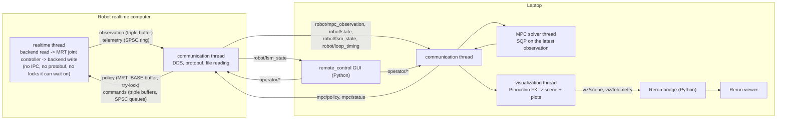

# Distributed runtime: robot, MPC and operator

This document describes how the humanoid NMPC runs as a set of processes that talk over **Cyclone DDS** with
**Protocol Buffers** messages, and how it is visualized with **Rerun**.

The design is driven by one deployment:

- the **realtime loop** (state estimation and the whole-body controller, i.e. the MRT joint controller) runs on the
  **robot's realtime computer**;
- the **MPC solver** runs on a **laptop**, connected over Ethernet or Wi-Fi;
- the **operator tools** (the remote-control GUI, teleoperation, the Rerun viewer) run on the laptop too.

**The MPC must never disrupt the realtime loop's rate.** Every rule below follows from that.

## Processes



<!-- LINT.IfChange(process_table) -->
| Process | Binary | Runs on | Role |
|---|---|---|---|
| robot | `humanoid_centroidal_mpc_robot`, `humanoid_wb_mpc_robot` (`--backend=mujoco`: the MuJoCo simulator) | robot computer, in the robot-runtime container (in simulation: the robot-sim container on the laptop) | realtime loop: backend, MRT joint controller, FSM, telemetry ([`humanoid_common_mpc_app/robot`](../../humanoid_common_mpc_app/robot/README.md)) |
| MPC | `humanoid_centroidal_mpc_node`, `humanoid_wb_mpc_node` | laptop | SQP solver, motion manager, contact planner, parameter updater, visualization publisher |
| dummy sim | `humanoid_centroidal_mpc_dummy_sim`, `humanoid_wb_mpc_dummy_sim` | laptop | plant = OCS2 rollout of the MPC model (no MuJoCo), through the same remote link |
| GUI | `remote_control:base_velocity_controller_gui` (Python, Tk) | laptop | velocity, FSM, gains, joint targets, MPC parameters, dodgeball |
| teleop | `remote_control:xbox_velocity_publisher`, `remote_control:keyboard_velocity_publisher` (Python), `humanoid_common_mpc_app/teleop:velocity_keyboard_command` (C++, a typed line) | laptop | velocity from an Xbox controller or the keyboard |
| Rerun bridge | `humanoid_rerun_viewer` (Python) | laptop | IPC messages -> Rerun |
| launcher | `tools/launch` (Python) | each machine | starts the processes of one machine from a launch file |
<!-- LINT.ThenChange(//humanoid_nmpc/humanoid_centroidal_mpc_app/BUILD.bazel:laptop_binaries, //humanoid_nmpc/humanoid_wb_mpc_app/BUILD.bazel:laptop_binaries, //humanoid_nmpc/humanoid_common_mpc_app/teleop/BUILD.bazel:teleop_binary, //humanoid_nmpc/humanoid_centroidal_mpc_app/BUILD.bazel:robot_binaries, //humanoid_nmpc/humanoid_wb_mpc_app/BUILD.bazel:robot_binaries) -->

**Simulation runs the hardware topology.** The robot process and the MPC node are separate processes in every
launch, talking over the remote link (`RemoteMpcLink` <-> `MpcServer`); the MuJoCo simulator is the robot process's
backend (`--backend=mujoco`), where a hardware backend will plug in under its own name. The robot binaries do not host
the MPC. `InProcessMpcLink` (the solver on a thread of the process, through `ocs2::MPC_MRT_Interface`) serves the
controller unit tests and the deterministic lockstep closed loop of `humanoid_nmpc/humanoid_mpc_validation`, which runs
its solver iterations itself (`InProcessMpcLink::Execution::kCaller`, `runSolverIteration()`) on the simulation's clock.

## IPC: a Cyclone DDS bus without ROS

`robot_runtime/robot_ipc` (C++) and its Python twin (`robot_runtime/robot_ipc/python/robot_ipc`) implement one
pattern on [Eclipse Cyclone DDS](https://cyclonedds.io) - the DDS library alone, without ROS, rmw or ROS IDL packages:

- Every process joins the DDS domain of the network file as **one DDS participant** named after its **node**.
- Every bus topic is a **DDS topic of the same name**, so any process may publish any topic and a subscriber does not
  need to know which process publishes it. DDS discovery matches writers and readers, so processes start, stop and
  restart in any order.
- Discovery is **unicast** to the host of every node of the network file (`AllowMulticast` false): multicast is
  unreliable over Wi-Fi and absent on a container's loopback. There is no broker.

The network file (`config/ipc/network.textproto`, chosen with `--network_config`) names the domain, the nodes, the QoS
of every topic and the transport. It is a textproto of `robot_ipc_proto.NetworkConfig`
(`robot_runtime/robot_ipc/proto/network_config.proto`):

```textproto
domain_id: 0
nodes { name: "robot"        host: "127.0.0.1" }  # the robot process (or the dummy simulation)
nodes { name: "mpc"          host: "127.0.0.1" }  # the MPC node, with its visualization publisher
nodes { name: "operator"     host: "127.0.0.1" }  # the remote_control GUI
nodes { name: "teleop"       host: "127.0.0.1" }  # keyboard / Xbox teleoperation
nodes { name: "config_push"  host: "127.0.0.1" }  # push_robot_config: a configuration file to the robot
topics { name: "mpc/policy"  qos_profile: "reliable_latest"  publishers: "mpc" }
...
transport { max_message_size_bytes: 65500 socket_receive_buffer_bytes: 8388608 }
```

Each process turns the file into its Cyclone DDS configuration (`robot_ipc/DomainConfig.h`, the same text in C++ and
Python) and passes it to `dds_create_domain()`: no XML file, and `CYCLONEDDS_URI` is never read. A node's process uses
the network interface of its node's host (one that is no address of its machine is refused), discovery goes to every
node's host with automatic process indices (`ParticipantIndex auto`, up to 20 processes per machine), a `domain_tag`
keeps two robots on one network (and the tests) apart, and a peer that vanished is unmatched after its 3 s lease. For
the hardware split both machines use the same file with the robot's and the laptop's addresses. The C++ and the Python
loader parse it strictly: an unknown field (the retired `port` and `bind_host` included), a value of the wrong type or a
syntax error is an error naming the file, the line and the column, and an invalid entry (a duplicate name, a wildcard
host, a topic that is no DDS name, an unknown QoS profile, a publisher that is no node) is an error naming it
([`robot_ipc`](../../../robot_runtime/robot_ipc/README.md#the-network-file)).

**Ports.** UDP only. A process with index i listens on `7400 + 250 * domain_id + 10 + 2 i` (discovery) and the port
after it (data), DDSI's port mapping: domain 0 uses **7410-7449** on every machine.

**Wire protocol.** Every sample is one `robot_ipc::Envelope` (`robot_runtime/robot_ipc/idl/Envelope.idl`, C type
support generated by `idlc` in the build): the wire protocol's version (2; 1 was the ZeroMQ framing that came before,
`robot_ipc/WireProtocol.h`), the writer's sequence number, the full protobuf type name (`humanoid_mpc_msgs.MpcPolicy`)
and the serialized message. Protocol Buffers stay the payload serialization. A bus refuses a sample of another protocol
version, counts it as `rejected` and logs which version the peer speaks, so that a robot and a laptop built from
checkouts that drifted apart say so at once. The type name lets the generic tool
([`tools/ipc`](../../../tools/ipc/README.md)) decode any topic without a registry: `bazel run //tools/ipc:ipc_tool --
echo mpc/status`, `hz robot/mpc_observation`, `list`.

**Quality of service.** Each topic of the network file names a profile (`robot_ipc/QosProfile.h`); every profile is
VOLATILE, so a process that restarts is never handed old commands:

| Profile | DDS policies | Topics |
|---|---|---|
| `latest` | BEST_EFFORT, KEEP_LAST 1 | `robot/mpc_observation`, `robot/state`, `robot/loop_timing`, `viz/telemetry`, `operator/walking_velocity_command` |
| `reliable_latest` | RELIABLE, KEEP_LAST 1 | `mpc/policy`, `mpc/status`, `robot/fsm_state`, `viz/scene`, `operator/mpc_parameters`, `operator/pd_gains`, `operator/joint_targets` |
| `reliable_events` | RELIABLE, KEEP_LAST 64 (the default of an unlisted topic) | `operator/fsm_command`, `operator/dodgeball_throw`, `operator/config_save`, `robot/config_save_status` |

A policy (0.5-0.75 MB) is hundreds of UDP fragments: under BEST_EFFORT one lost fragment would lose the whole policy,
so `reliable_latest` repairs lost fragments, while a newer policy replaces one that is still being repaired, so that a
slow link never builds a backlog. A stream that comes again every cycle is `latest`: a lost sample is replaced by the
next one rather than sent again. The nodes a topic lists as `publishers` create its DDS writer when their bus is
created, so the subscribers have discovered it before a one-off command is written (a VOLATILE reader gets only what is
written after it matched). A reliable write never waits for acknowledgments: at the writer's unacknowledged-bytes limit
(8 MiB by default) DDS refuses it, and the bus counts it as `sendDropped`.

**Delivery.** A subscriber picks per topic:

- `kLatest`: each time the IO thread drains the topic's reader (which keeps the newest 4 samples), only the newest is
  handed over. Used for every stream (observations, policies, velocity commands, parameter documents, joint targets,
  telemetry for the scene).
- `kAll`: every sample, in order (the reader keeps 256). Used for discrete events (FSM commands, dodgeball throws) and
  for plots.

One drain takes the samples of every topic and dispatches them in the order they were written - by their source
timestamps, which every bus makes strictly increasing across its topics: `kAll`'s every sample, `kLatest`'s newest one
at the place it was written. Within a drain, a handler never sees a sample of one topic before an earlier one of another
topic from the same publisher (an FSM command before the parameter update the GUI sent ahead of it). DDS gives no such
guarantee across drains: the topics are separate readers, and a large sample being repaired may arrive after a small
one written later.

**After a stall.** A subscriber that falls behind - a stalled process or a slow link - is handed the newest value of a
latest-value topic, not a backlog: the writer keeps one sample and the reader four, whichever node publishes it
(`robot_ipc`'s `BusDeliveryTest.AStalledSubscriberGetsTheNewestLatestValueNotABacklog`). This replaces the per-node
ZeroMQ send queues (`NodeBusProfile`) that bounded the same backlog before: the bound is now the topic's QoS.

**What the counters say** (`Bus::topicStatistics()`, `TopicStatistics.h`). `written` counts samples handed to the DDS
writer, not samples delivered. A subscriber counts `received` (taken from its reader), `delivered`, `superseded` (the
older `kLatest` samples of a drain) and `rejected`, with received = delivered + superseded + rejected; `missed` counts
the gaps in each writer's sequence numbers, the samples a matched writer wrote that the reader never took (replaced in a
KEEP_LAST history, or lost under BEST_EFFORT). From DDS itself: `sampleLost` and `sampleRejected` of the reader,
`incompatibleQos` (a RELIABLE reader and a BEST_EFFORT writer from two different network files never match), and
`matchedReaders` / `matchedWriters`, the peers currently up, which take the place of ZeroMQ's heartbeats and reconnects.
DDS cannot say which subscriber a BEST_EFFORT sample did not reach; the subscriber's `missed` against the publisher's
`written` shows what a link lost.

**Threads.** The DDS readers and writers belong to one thread, the bus's IO thread, which waits on a DDS waitset.
Handlers and periodic callbacks run on it. `Bus::publish()` may be called from any non-realtime thread (it serializes on
the caller and hands the bytes to the IO thread; only the IO thread calls `dds_write()`). **The realtime thread never
calls the bus.**

### Topics

The names are constants in `humanoid_nmpc/humanoid_mpc_ipc/include/humanoid_mpc_ipc/Topics.h` and
`humanoid_nmpc/humanoid_mpc_ipc/python/humanoid_mpc_ipc/topics.py`, tied together with `LINT.IfChange`. The messages
are those of `humanoid_nmpc/humanoid_mpc_msgs`, except the two tuning payloads of the GUI, which are whole
configuration files of `humanoid_nmpc/humanoid_mpc_config`: `MpcParameterUpdate` (the task file and, for a robot that
plans its contacts, the contact planner's file) and `JointPdGainsUpdate` (the PD gains file, paired with its configuration identity).
The payload is the file: a block it does not carry means its defaults, as at start-up. A subscriber drops, and logs, a message
of another type than its own. A payload of the same type built from another version of the schemas is refused by the receiver,
logged and counted: one with a field the receiver does not know, and an `MpcParameterUpdate`, a `JointPdGainsUpdate` or a
`ConfigFileSave` whose schema fingerprint is not the receiver's (humanoid_nmpc/humanoid_mpc_config/README.md, "Version skew").
Both also name the configuration they are of (`config_path`, the file's path from `robot_models/` on: `configFileIdentity()`),
and the MPC node and the robot refuse one of another configuration, such as a centroidal G1 GUI's update reaching the whole-body G1,
whose `robot_name` is the same.

<!-- LINT.IfChange(topic_table) -->
| Topic | Message | Publisher | Subscribers | Delivery | QoS | Rate |
|---|---|---|---|---|---|---|
| `robot/mpc_observation` | `MpcObservation` | robot | MPC | latest | `latest` | every control cycle |
| `robot/state` | `RobotStateSample` | robot | MPC (visualization) | all | `latest` | `telemetry_frequency` |
| `robot/fsm_state` | `FsmState` | robot | GUI | latest | `reliable_latest` | on change and 2 Hz |
| `robot/loop_timing` | `LoopTiming` | robot | bridge | latest | `latest` | 1 Hz |
| `mpc/policy` | `MpcPolicy` | MPC | robot, dummy sim | latest | `reliable_latest` | every solve |
| `mpc/status` | `MpcStatus` | MPC | robot (solver health), bridge | latest | `reliable_latest` | every solve attempt |
| `viz/scene` | `VisualizationScene` | MPC (visualization) | bridge | latest | `reliable_latest` | `rerun_scene_frequency` |
| `viz/telemetry` | `TelemetrySeries` | MPC (visualization) | bridge | all | `latest` | per `robot/state` sample |
| `operator/walking_velocity_command` | `WalkingVelocityCommand` | GUI, teleop | MPC; robot (gantry height in sim) | latest | `latest` | 25 Hz |
| `operator/fsm_command` | `FsmCommand` | GUI | robot | all | `reliable_events` | on change |
| `operator/mpc_parameters` | `MpcParameterUpdate` | GUI | MPC; robot (controller-side settings) | latest | `reliable_latest` | on edit |
| `operator/pd_gains` | `JointPdGainsUpdate` | GUI | robot | latest | `reliable_latest` | on edit |
| `operator/joint_targets` | `JointTargets` | GUI | robot | latest | `reliable_latest` | on edit, JOINT_PD only |
| `operator/dodgeball_throw` | `DodgeballThrow` | GUI | robot (simulation) | all | `reliable_events` | on button press |
| `operator/config_save` | `ConfigFileSave` | GUI, `push_robot_config` | robot (its persistent copy) | all | `reliable_events` | on Save |
| `robot/config_save_status` | `ConfigFileSaveStatus` | robot | GUI, `push_robot_config` | all | `reliable_events` | once per save |
<!-- LINT.ThenChange(//humanoid_nmpc/humanoid_mpc_ipc/include/humanoid_mpc_ipc/Topics.h:topics, //humanoid_nmpc/remote_control/remote_control/operator_bus.py:operator_topics, //config/ipc/network.textproto:topic_qos) -->

The MPC keeps the last `operator/walking_velocity_command` it received, so every publisher leaves the stop command (zero
velocities, the pelvis height kept) behind when its source goes away: the GUI when its Xbox controller is lost or its
**Publish walking commands** is unticked, the Xbox publisher when its controller goes away, and every teleoperation
publisher when it ends (humanoid_nmpc/remote_control/README.md, humanoid_nmpc/humanoid_common_mpc_app/teleop/README.md).
A publisher killed with SIGKILL, or a laptop cut off from the robot, sends nothing; against that the MPC nodes read the
task file's `interface.walking_command_timeout` (seconds, positive; 0.5 by default), past which a command that was not
renewed is replaced by the stop command once, until the next one arrives (`MpcNodeRuntime::Config::walkingCommandTimeout`).
Every publisher renews its command at 25 Hz, so the half second outlasts a dozen lost messages.

### Saving the configuration

The MPC node and the robot process run in two processes, on two machines on the robot, and each reads its own copy of
the robot's configuration files. The tuning GUI's **Save** therefore writes both: the laptop's file, which the MPC node
reads and watches, losslessly (comments and untouched values kept), and the robot's, by sending the exact text it wrote
of every file the robot reads - the task file, the reference file, the PD gains file; not the contact planner's file,
which only the MPC reads - on `operator/config_save` (`ConfigFileSave`: the file's kind, `robot_name`, `config_path`,
the schema fingerprint of the file's message, the text and a sequence number).

The robot process keeps its files in a persistent store (`--config_store_dir`; the robot images use
`/var/lib/wb-humanoid-robot/config/<ROBOT>`, a directory of the robot's host that outlives the container and a
redeploy), seeded from the files bundled in its image
([`humanoid_common_mpc_app/robot`](../../humanoid_common_mpc_app/robot/README.md#the-configuration-store),
[`tools/deploy`](../../../tools/deploy/README.md#the-stored-configuration)). Its `ConfigFileStore` checks a save on the
bus's IO thread for what is cheap - the configuration, the robot, the schema fingerprint, the size - and then, on a
writer thread of its own, never the realtime thread, parses it as strictly as at start-up and runs the checks start-up
runs (`checkRobotConfiguration()`) with the saved file in place of its stored copy. A file it accepts is written
atomically (the previous copy kept as `.bak`), and its watchers apply it as they apply an edit; the answer goes back on
`robot/config_save_status` (`ConfigFileSaveStatus`: `SAVED` with the stored path, `UNCHANGED`, `REFUSED` or `FAILED`
with the reason, `NOT_STORED` for a robot process without a store, naming the file it reads in place). The GUI shows it:
saved on the laptop and on the robot, or the robot's refusal; a robot without a store that reads another file than
the laptop's (a robot computer of its own) as a problem, since the save did not reach it; an answer that does not come
leaves the robot's copy unknown, and a repeat of the same save is answered again without being written twice. The
robot reads its stored files at its next start; a stored file it does not start with, where the bundled one starts, is
renamed `.rejected` and the robot starts on the bundled one, while a failure the bundle shares (a port in use) keeps
the stored files. `bazel run //humanoid_nmpc/remote_control:push_robot_config -- <file>` sends a file the same way from the command
line, as the bus node `config_push` (an editor's save, which the robot does not see otherwise).

### Trust model

The bus has no authentication. Anything that can publish on it can command the robot's FSM, change its PD gains live
and, with `operator/config_save`, replace the robot's three configuration files - so the bus belongs on the robot's
private network (the addresses of the network file), never on an open one, and its ports (UDP 7410-7449 for domain 0) are
open only between the robot and the laptop. The checks limit what a save can do, not who sends it: the store writes only its three
fixed files (the message's `config_path` is compared with the configuration's, never joined into a path, and the contact
planner's mirror has no kind), refuses whatever the robot would refuse at start-up, caps the size and the queue, keeps
`.bak`, `.seed` and `.rejected`, and falls back to the bundled files when a stored configuration does not set up or dies
in its first seconds. The configuration identity (`config_path`) on the live path and on Save guards against operator
mistakes, a GUI opened on another configuration; it is not authentication.

## The realtime thread

The realtime thread of the robot process does, every period, only this:

1. read the latest robot state from the backend (`RobotHWInterfaceBase`), through the task file's state estimator:
   `ground_truth` (the default) hands it on, `kalman` replaces the base's position and linear velocity with a linear
   Kalman filter's estimate from the IMU's acceleration and the leg kinematics of the stance feet
   (`humanoid_state_estimation`), allocation-free;
2. take the latest operator commands from lock-free mailboxes (`robot::TripleBuffer` for latest-value data, a
   bounded `robot::realtime::SpscQueue` for events);
3. run the MRT joint controller (`computeJointControlAction`), which evaluates the policy in use;
4. hand the joint action to the backend;
5. write the MPC observation into a triple buffer and, every `telemetry_frequency`, a telemetry sample into an SPSC
   ring.

It never calls DDS or protobuf, never parses a configuration file, never touches a file, never logs in steady
state, and never waits on a lock another thread can hold for long: the policy swap is `MRT_BASE::updatePolicy()`, a
`try_lock` that skips the swap if the communication thread is moving a new policy in.

The loop is paced with absolute deadlines (`clock_nanosleep(TIMER_ABSTIME)` on `CLOCK_MONOTONIC`). With
`--realtime_priority=N` (0 = off) it runs `SCHED_FIFO` at priority N with its memory locked (`mlockall`), on the
cores of `ThreadAffinity.h`. A setting the process may not have is reported and skipped, and the others still apply. The
MPC's solver thread can run `SCHED_FIFO` too, without locking the memory of the MPC process, which allocates as it
solves. Period statistics go out on `robot/loop_timing`. The building blocks for all of this
(`SpscQueue`, `PeriodicTimer`, `LoopTimingStats`, `configureCurrentThread`) are in `robot_runtime/robot_realtime`,
which depends on Abseil only.

The **communication thread** does everything else: it publishes observations and telemetry, receives and parses
policies (allocating, then `MRT_BASE::moveToBuffer`, which frees the replaced policy on this thread), converts the
GUI's typed tuning messages (the whole task file, the whole PD gains file, a dodgeball throw) into the controller's
structures, and runs the reset handshake below.

## The MPC link

`humanoid_nmpc/humanoid_mpc_ipc` holds the conversions between OCS2 types and the messages
(`MpcMessageConversions.h`), the robot side of the link (`RemoteMpcLink.h`, target `:remote_mpc_link`) and the MPC
side (`MpcServer.h`, target `:mpc_server`); see [its README](../../humanoid_mpc_ipc/README.md).

The controller talks to an `MpcLink` (`humanoid_common_mpc/mrt/MpcLink.h`), an `ocs2::MRT_BASE` with a solver behind
it. `InProcessMpcLink` implements it; `RemoteMpcLink` derives `ocs2::MRT_BASE` directly, and the robot process hands it
to the controller through `RemoteMpcLinkAdapter` (`humanoid_common_mpc_app/robot`):

| | `InProcessMpcLink` | `RemoteMpcLink` |
|---|---|---|
| solver | `ocs2::MPC_MRT_Interface` on a thread of this process, or on the caller's (`Execution::kCaller`) | the MPC node (`MpcServer`), over the bus |
| `setCurrentObservation()` | copy under the observation mutex | write into a triple buffer (no lock, no allocation) |
| policy in | `advanceMpc()` -> `moveToBuffer()` on the solver thread | `mpc/policy` -> parse -> `moveToBuffer()` on the bus's IO thread |
| resets | served by its solver thread | requested through the observation's counters, served by the MPC node |
| `resetMpcNode()` | resets at once | requests a full reset and returns at once |
| health | its own `MpcResetSupervisor` | the node's, reported in `MpcPolicy.solver_status` and `mpc/status`; plus the policy timeout |

### Resets across the network

The robot's `MpcResetSupervisor` keeps two counters, resets requested and full resets requested. They only grow.
Every `MpcObservation` carries them, so a lost message loses nothing and a duplicated one changes nothing.

1. The robot requests a reset (mode change into WB_MPC, a caught fall, a clock rewind, a diverging policy). Its
   communication thread sees the new count, calls `discardBufferedPolicy()` (the policy in use stops being "current"),
   and keeps the ticket open.
2. The MPC node sees `requested > served` in the next observation, resets (fully if `full_requested > full served`)
   from that observation, solves, and stamps every policy with the counters it has served. Its first reset, before its
   first solve, is a full one, and so is the reset after the robot process restarted (sequence numbers or counters that
   went backwards).
3. The robot drops any policy whose `resets_served` is below what it requested (solved before the reset it asked for)
   and completes the ticket when the first policy that serves it arrives. From then on the controller sees
   `isActivePolicyCurrent() && !hasOutstandingReset()`, exactly as with the in-process solver.

Failures are handled where the solver is: the MPC node's own `MpcResetSupervisor` resets and backs off. A failed solve
publishes no policy, so its health travels in every policy and in the `mpc/status` of every attempt; the robot mirrors
it into its supervisor, so the controller's hold in JOINT_PD while the MPC is unhealthy works unchanged. When the MPC
node reports a failed solve the robot drops the buffered policy, as the in-process solver does when it resets after the
failure: the policy in use is no longer current until one solved after the failure arrives. In that interval the
in-process controller sees `hasOutstandingReset()` (its supervisor requested the solver's reset), the remote one sees
`!isActivePolicyCurrent()` (the MPC node's supervisor requested it); the controller only reads the two together.

**Link loss.** If no policy solved from an observation of the last `mpc_link.policy_timeout` seconds of robot time has
arrived, the link reports itself unhealthy and the controller holds the robot in JOINT_PD, as for a failing solver; a
policy that is older than the timeout when it arrives, or whose horizon has ended by then, is dropped. A plan is never
executed past the end of its horizon: the link is lost, too, when the robot clock reaches the end of the policy that may
be in use - the newest one, or the older one the controller still runs when the newest was dropped from the buffer
before its swap (a reset, a failed solve).
The realtime thread checks both itself, every cycle, against the deadline the communication thread publishes with each
policy it accepts, so that a stalled communication thread cannot keep a stale plan in use. The communication thread
then drops the buffered policy and requests a full reset, as the in-process supervisor does once it declares a failing
solver unhealthy: the hold ends, with the usual entry blend, on the first policy solved after that reset, from the robot
as it is then, not on one that resumes the gait schedule the MPC kept running through the loss. A clock that runs
backwards restarts the timeout but does not end a loss. A policy solved from an observation the robot did not send
(another robot process on the bus, or an MPC node still answering a previous one) is dropped.

The realtime thread evaluates the policy in use with `RealtimePolicyEvaluator` (`humanoid_mpc_ipc`), which computes what
`MRT_BASE::evaluatePolicy()` does without its heap allocations and its logging; both MRT joint controllers use it, with
the in-process link too. On a state manifold (`RemoteMpcLink::Config::stateManifold`, the evaluator given the same) the
policy is the SQP's `ManifoldLinearController` (`CONTROLLER_TYPE_MANIFOLD_LINEAR`, its anchor states sent with it),
which the evaluator executes through the manifold's allocation-free `differenceInto()` and `interpolateInto()`; a policy
of the other kind is refused on either side. The policy's `annotations` (the contact planner's target contact patches and the scaled walking
command) reach the robot process's communication thread through `RemoteMpcLink::takeAnnotations()`, which draws them in
the MuJoCo viewer.

### Bandwidth

A policy's controller costs, per node, `nu` doubles for a feedforward policy, `nu (nx + 1)` for a linear one (feedback
gains on the stored state) and `nu + nx + nu ndx` for a manifold-linear one (the `ManifoldLinearController` of a solver
on a state manifold: the nominal input, the anchor state, and the gains on the `ndx` tangent directions), on top of the
state and input trajectories. A feedforward policy is about 46 KB, a linear one about 480 KB for nx = nu = 30 over 60
nodes, and a manifold-linear one about 490 KB with a quaternion in the state (nx = 31, ndx = nu = 30)
(`humanoid_mpc_ipc:test_mpc_message_conversions` prints all three). At 50-80 Hz the latter two are 24-40 MB/s, too much
for Wi-Fi. `mpc.solution_time_window` (OCS2's MPC settings) bounds the horizon that is sent: the MPC node cuts every policy
to it (`trimToSolutionWindow()`, upstream OCS2 GaussNewtonDDP's rule), also for `SqpSolver`, which ignores it in
process. Every shipped task file keeps the full horizon (it leaves the field out). A DRC Atlas policy (nx = 37) is roughly 0.75 MB, under
40 MB/s at about 50 Hz (`make ipc-hz TOPIC=mpc/policy` measures it), which loopback carries easily and a gigabit link
with room. Before a robot runs over a slower link, set `solution_time_window` to what the robot needs between two
policies (a few MPC periods).

## Visualization with Rerun

The visualization publisher ([`humanoid_common_mpc_app/visualization`](../../humanoid_common_mpc_app/visualization/README.md))
runs on a low-priority thread of the MPC node: `humanoid_centroidal_mpc_node` and `humanoid_wb_mpc_node` always attach
it. The solver thread's post-solve hook hands it the latest observation and policy, and its `robot/state` subscription every sample, through lock-free mailboxes that never
block the solver; samples that do not fit its bounded queue are dropped and counted. It computes everything with
Pinocchio and the MPC's robot model, and publishes:

- `viz/scene`: the robot model instances (measured, with every joint of the URDF; terminal state; terminal target) as
  link poses, and the markers, at `rerun_scene_frequency` (30 Hz) at most;
- `viz/telemetry`: the plots, one message per `robot/state` sample: measured, reference and plan.

The Rerun bridge (`humanoid_nmpc/humanoid_rerun_viewer`, [its README](../../humanoid_rerun_viewer/README.md)) loads
the robot's URDF meshes once per instance, sends the blueprint, and maps every message onto Rerun archetypes. It
subscribes to `viz/scene`, `viz/telemetry`, `robot/fsm_state`, `mpc/status` and `robot/loop_timing`, and runs anywhere
on the bus. The sink is chosen by name: by default (`--rerun_sink spawn`) it spawns the native viewer;
`--rerun_sink serve_web` serves the web viewer instead (open `http://localhost:9090` from the host when the bridge runs
in the dev container), `connect` streams to a running viewer and `save` writes an `.rrd` file. Its README tabulates the
entity paths and the telemetry groups the visualization publisher must send: the contract between the two.

<!-- LINT.IfChange(rerun_mapping) -->
| Rerun entity | What it draws |
|---|---|
| `world/robots/measured` | the measured robot, every joint of the URDF |
| `world/robots/terminal_state` | the robot at the last node of the plan (not drawn with the shipped plot configuration, `draw_terminal_state: false`; `--terminal_state` on the bridge draws it) |
| `world/robots/terminal_target` (hidden by default) | the robot at the target trajectory's state at the plan's final time |
| `world/markers/contact_forces`, `world/markers/center_of_pressure`, `world/markers/corner_forces` (hidden) | the end-effector forces at the center of pressure, the center of pressure, the equivalent corner forces |
| `world/plan/end_effectors`, `world/plan/base`, `world/plan/com`, `world/plan/footholds` | the plan's end-effector, base and CoM trajectories and its future footholds |
| `world/markers/collision_spheres` (hidden) | the collision spheres |
| `telemetry/<path>` | the blueprint's plot tabs: the panel tabs and the tabs of the complete groups (the telemetry contract) |
<!-- LINT.ThenChange(//humanoid_nmpc/humanoid_rerun_viewer/python/humanoid_rerun_viewer/scene_contract.py:robot_instances, //humanoid_nmpc/humanoid_rerun_viewer/python/humanoid_rerun_viewer/scene_contract.py:markers) -->

## Configuration

<!-- LINT.IfChange(command_line_flags) -->
- **Command line** (Abseil flags): every binary takes `--robot_name --task_file --reference_file --gait_file
  --urdf_file --network_config --ipc_node` (the robot binaries and the dummy simulators accept `--gait_file` but do not
  read it); the MPC nodes have no flag of their own beyond these (their solver threads' priority is the task file's
  `multiple_shooting.thread_priority`, their walking command timeout `interface.walking_command_timeout`), but for the
  multi-contact plan: the centroidal MPC's node and dummy simulator add `--multi_contact_scenario --multi_contact_plan
  --multi_contact_playback` (the scenario and the plan tracked under `contact_schedule_source: "multi_contact_plan"`,
  and how the plan plays, `once` or `forward_and_reverse`; empty: the task file's `multi_contact_plan` block,
  [multi_contact_planning](../multi_contact_planning/README.md)); the robot
  binaries add `--mjcf_file
  --realtime_priority --backend --realtime_cores --backend_cores --viewer --plot_config --web_viewer_address
  --web_viewer_port --web_viewer_allowed_hosts --viewer_cores --config_store_dir --config_seed`
  ([`humanoid_common_mpc_app/robot`](../../humanoid_common_mpc_app/robot/README.md#the-command-line)).
<!-- LINT.ThenChange(//humanoid_nmpc/humanoid_common_mpc_app/node/src/MpcAppFlags.cpp:mpc_app_flags, //humanoid_nmpc/humanoid_centroidal_mpc_app/src/CentroidalAppFlags.cpp:centroidal_app_flags, //humanoid_nmpc/humanoid_centroidal_mpc_app/src/CentroidalMpcNodeMain.cpp:node_flags, //humanoid_nmpc/humanoid_centroidal_mpc_app/src/CentroidalMpcDummySimMain.cpp:dummy_sim_flags, //humanoid_nmpc/humanoid_common_mpc_app/robot/src/RobotAppFlags.cpp:robot_flags) -->
- **Task file** (`config/mpc/task.textproto`): `mpc_link.policy_timeout`, `telemetry_sinks` (the robot process's
  telemetry, by name: `bus` publishes `robot/state`), `telemetry_frequency`, `telemetry_frames`, `rerun_scene_frequency`,
  `rerun_plan_frames`, and the existing controller and simulator fields
  ([`humanoid_common_mpc_app/robot`](../../humanoid_common_mpc_app/robot/README.md#the-task-file)).
- **Network file**: as above.

## Launching

Every robot configuration has three launch files in `robot_models/<robot>/<package>/launch/`, and every robot
description a fourth:

<!-- LINT.IfChange(launch_files) -->
| Launch file | Machine | Processes | Make target |
|---|---|---|---|
| `robot.textproto` | robot | the robot process (`--backend`, `--realtime_priority`, the cores); the robot images run it exported as `launch/<robot>.sh` | `launch-<robot>-robot`, `deploy-robot` |
| `mpc.textproto` | laptop | the MPC node, the remote-control GUI, the Rerun bridge | `launch-<robot>-mpc NETWORK=`, and the laptop side of `launch-<robot>-sim` |
| `dummy_sim.textproto` | laptop | the MPC node, the dummy simulator (bus node `robot`), the GUI, the bridge | `launch-<robot>-dummy-sim` |
| `<robot>_description/launch/sandbox.textproto` | laptop | the model sandbox (the URDF at its nominal or slider-set joint positions) and the bridge | `launch-<robot>-sandbox` |
<!-- LINT.ThenChange(//robot_models/tests/test_launch_files.py:robot_configurations, //Makefile:launch_targets) -->

Their variables name the robot's files relative to the repository root (`task_file`, `reference_file`, `urdf_file`,
`mjcf_file`, `gait_file`, `network_file`, `plot_config`) and the settings a deployment changes (`backend`, `viewer`,
`realtime_priority`, `realtime_cores`, `backend_cores`, `config_store_dir`, `config_seed`, `rerun_sink`); `--set name=value` overrides one.
`//robot_models/tests:test_launch_files` checks that every one parses, starts built binaries with flags they define and
files that exist, and keeps the robot process and the MPC apart.

`bazel run //tools/launch -- <launch file>` ([`tools/launch`](../../../tools/launch/README.md); the built binary is
`.bazel/bin/tools/launch/launch`) starts the processes a launch file lists, each in its own process group, prints
their output with a colored prefix, and stops all of them (SIGINT, then SIGTERM, then SIGKILL) when one marked
`required` exits or on Ctrl-C. A launch file is a textproto of `launch_proto.LaunchFile`
(`tools/launch/proto/launch_file.proto`), parsed strictly. `--machine robot` / `--machine laptop` starts only the
processes of one machine, for the hardware split; `--dry_run` prints the resolved commands and `--set name=value`
overrides a variable of the file. The Makefile's `launch-*` targets build with Bazel and call it.

## Deployment

The robot side ships as a container ([`tools/deploy`](../../../tools/deploy/README.md)): `//tools/deploy:robot_bundle`
(the robot binaries with their runfiles, every robot model, the entry scripts) built in the dev container, the
`robot-runtime` image of `docker/Dockerfile` built from it on the laptop - Ubuntu, the shared libraries the binaries
link, nothing to build with - and `docker-compose.robot.yaml`, which runs it with what the realtime loop needs. The
laptop runs the MPC node, the GUI and the Rerun bridge from the dev container.

**Bring-up.**

1. Write a network file with both machines' addresses (a copy of `config/ipc/two_machine.example.textproto`: each
   process uses the interface of its node's `host`, and discovery goes by unicast to both hosts), open the bus's ports,
   UDP 7410-7449 for domain 0, on both machines for the other one, and let both kernels give the 8 MiB receive buffer: the Makefile's launch and deploy targets raise
   `net.core.rmem_max` to the network file's request on both machines (sudo, once per machine; `make udp-buffers`,
   tools/deploy/README.md).
2. On the laptop: `make deploy-robot ROBOT=<robot> HOST=<robot's ssh host> NETWORK=<file> SERVICE=enable`. It builds
   the bundle and the image, ships the image over ssh (`docker save | docker load`, or `REGISTRY=`), installs
   `~/wb-humanoid-robot` (the compose file, the network file, a `.env`) and the systemd unit
   `wb-humanoid-robot@<robot>`, which starts the robot side now and at every boot.
3. On the laptop: `make launch-<robot>-mpc NETWORK=<file>`. The GUI's FSM selector then takes the robot from
   ZERO_TORQUE through JOINT_PD into WB_MPC.

`make launch-<robot>-robot HOST=<host>` runs the deployed robot side in the foreground instead of the unit, its log on
the laptop's terminal. The robot's computer needs Docker with the compose plugin, and nothing of the repository.

**Simulation mirrors the hardware.** `make launch-<robot>-sim` runs the same split on one machine: the robot side in the
`robot-sim` container - `robot-runtime` plus only the MuJoCo viewers' GL and EGL, with the same compose file, the same
`SCHED_FIFO` and locked memory - and the laptop side in the dev container, over the remote MPC link on the shipped
localhost network. Nothing runs the MPC inside the robot process (the robot binaries have no in-process mode;
`InProcessMpcLink` is for the controller unit tests and the lockstep closed loop). The robot container's bundled files
are the checkout's `robot_models`, mounted read-only, which seed its stored configuration at every start; while it runs,
the GUI's Save reaches it over the bus, as on the robot ("Saving the configuration", tools/deploy/README.md,
"Simulation"). `NETEM="delay 3ms 1ms loss 0.5%"` shapes
the bus's UDP packets on loopback with tc-netem while the robot container runs, to rehearse the robot's link
(`tools/deploy/netem.sh`). The MuJoCo viewer is chosen by name: the `mujoco_viewer` of the plot configuration
(`humanoid_nmpc/humanoid_rerun_viewer/config/plot_config.textproto`, `PLOT_CONFIG=`) unless `--viewer` (`VIEWER=`,
`WB_ROBOT_VIEWER`) or a named `VIEWS=` does (`VIEWS=browser|vnc|display`, the same on every launch target, the
robot's `-mpc` included: browser tabs for MuJoCo, Rerun and the GUI through noVNC; all on the VNC desktop; or native
windows on `DISPLAY`; `.devcontainer/README.md`, "Views"). `web`, the default, renders offscreen and serves the view to a browser tab at
`http://localhost:6090` (loopback only; `ssh -L 6090:127.0.0.1:6090 <host>` from another machine); `glfw` is a window
on the VNC desktop; `none` runs without one. Until a robot's hardware backend exists, the robot deployment runs the MuJoCo backend without a viewer (`none`,
robot-runtime's default) on the robot's computer: a true two-machine simulation. A hardware backend registers under a name of its own
(`RobotBackendRegistry`) and is selected with `WB_ROBOT_BACKEND` (`make deploy-robot BACKEND=`). It names the `hardware`
supervisor (`RobotBackend::supervisorName()`, `RobotSupervisorRegistry`): its FSM bridge switches the backend's torques
(`enableTorques()`, `enterSafeState()`) and ignores the gantry commands, and its fall recovery switches the torques off
when the base tilts past `sim_max_base_tilt_angle`, where the simulator's (`sim`) drive the gantry, the dodgeballs and
the simulator's resets. The backend publishes the IMU's specific force with the state, and the task file's
`state_estimator: "kalman"` estimates the base's position and velocity a robot cannot measure. The steps are in
[`humanoid_common_mpc_app/robot`](../../humanoid_common_mpc_app/robot/README.md#a-hardware-backend); its
`:test_hardware_supervisor` runs the whole robot process on a fake backend that is no simulator.

**Start order does not matter.** The robot process comes up in ZERO_TORQUE (on the gantry in simulation) whatever the
MPC does, and streams `robot/mpc_observation` until a policy arrives; the MPC node answers whichever robot process
sends observations, and a restart of either side is a full reset of the MPC (sequence numbers or counters going
backwards). DDS discovery matches the writers and readers of a process that (re)starts, and unmatches those of one that
went away after its 3 s lease, so either side may start, stop and restart in any order; the policy timeout below does
not rely on it. The container's
restart policy brings a robot process that exits back - in ZERO_TORQUE, so an operator has to take it into WB_MPC
again.

**Link loss holds the robot.** Without a policy solved from an observation of the last `mpc_link.policy_timeout`
(0.5 s) of robot time, WB_MPC holds the JOINT_PD action, `robot/fsm_state` reports `mpc_healthy: false`, and the
first policy solved after the full reset it requests ends the hold with the usual entry blend ("Link loss" above). The
hold is not ramped in, so a false loss is a jump to the standing posture. The timeout was set when the bus ran on TCP,
where a lost segment cost a retransmission timeout of at least 200 ms (Linux's TCP_RTO_MIN): with the earlier 0.2 s
timeout, every single lost segment read as a lost link - twice in one NETEM run (`delay 3ms 1ms loss 0.5%`), once under
the robot standing free in WB_MPC. On DDS a lost fragment of a `reliable_latest` policy is repaired after a NACK, within
a few round trips, and a newer policy may replace it; 0.5 s still outlasts a burst of losses with margin and leaves at
least half of every shipped policy horizon (1.0-1.2 s). The hold is the robot's own clock against the policy's
observation time, independent of DDS liveliness.

**Realtime in the container.** The realtime thread runs `SCHED_FIFO` with its memory locked (`--realtime_priority`,
80 by default in `robot.textproto`): the compose file adds `CAP_SYS_NICE` and `CAP_IPC_LOCK` and sets the `rtprio` and
`memlock` limits, and nothing else - no privileged mode, no device. This needs a kernel without
`CONFIG_RT_GROUP_SCHED` (Ubuntu's kernels have none), or one whose cgroup gives Docker's containers a realtime budget;
otherwise `sched_setscheduler` fails in the container and the loop runs on the time-sharing scheduler, which the robot
process logs. A PREEMPT_RT kernel is recommended on the robot's computer, with the realtime cores kept free
(`isolcpus`, `WB_ROBOT_CPUSET`, `WB_ROBOT_REALTIME_CORES`). The container's memory is capped without swap
(`WB_ROBOT_MEMORY_LIMIT`, 4 GB), the rule of AGENTS.md for the robot.

Measured on the development workstation (20 cores, Ubuntu's PREEMPT_DYNAMIC generic kernel, no PREEMPT_RT), DRC Atlas
in `make launch-drc-atlas-sim` with the viewer on an X server, a scripted operator taking it from JOINT_PD into WB_MPC,
off the gantry, standing, walking at 0.3 m/s and stopping (25 s operated): the realtime thread `robot_rt` at
`SCHED_FIFO` 80 on cores 4-5 with the process's memory locked, 0 overruns, the 10 ms period held to within 0.2 ms, at
most 0.9 ms of compute per cycle; solves 9.0 ms median, 10.3 ms p99; the newest policy 20 ms old (40 ms at most) at the
robot. Under NETEM: the same loop timing, the policy 30 ms old (40 ms at most), no fall.
