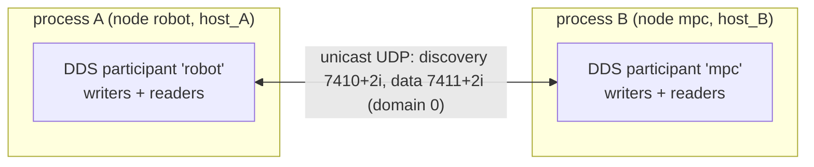

# robot_ipc

The Cyclone DDS bus of the distributed runtime, in C++ (`robot::ipc`, target `:robot_ipc`) and in Python
(`import robot_ipc`, target `:robot_ipc_py`). The design, the processes and the topics of the humanoid are in
[`humanoid_nmpc/docs/distributed_runtime/README.md`](../../humanoid_nmpc/docs/distributed_runtime/README.md); this
package is generic and knows none of its messages (the shipped network file only names the humanoid's topics to give
each its quality of service).

It uses [Eclipse Cyclone DDS](https://cyclonedds.io) directly: the C library `ddsc` of the BCR module `cyclonedds`
(MODULE.bazel), linked statically, and in Python the `cyclonedds` wheel of the same release, which bundles its own
`libddsc`. There is no ROS: no rmw, no ROS IDL packages, no colcon or ament.

## The pattern



- Every bus is **one DDS participant** of the network file's domain (`domain_id`), named after its node. A bus without
  a node name (`nodeName` empty) only subscribes.
- Every bus topic is a **DDS topic of the same name**: letters, digits, `_` and `/`, not starting with a digit
  (Cyclone DDS's rule; `validateTopicName()`), so a DDS tool such as `ddsls` shows the bus's own names. Any process
  may publish any topic, and a process receives its own topics too. DDS discovery matches writers and readers, so
  processes start in any order and survive each other's restarts.
- **Wire protocol**: every sample is one `robot_ipc::Envelope` (`idl/Envelope.idl`):

  ```idl
  @final struct Envelope {
    uint32 protocol_version;   // kWireProtocolVersion, 2
    uint64 sequence_number;    // 1, 2, 3, ... per writer
    string type_name;          // e.g. "humanoid_mpc_msgs.MpcPolicy"
    sequence<octet> payload;   // the serialized protobuf message
  };
  ```

  `idlc`, the IDL compiler of the `cyclonedds` module, generates its C type support in the build
  (`:envelope_type_support`); the Python bus declares the same struct (`python/robot_ipc/envelope.py`) and packs the
  payload as one `bytes` object in the same XCDR encoding. The C++ and the Python bus interoperate on the wire
  (`:cross_language_test`).
- **Protocol version**: a bus refuses a sample whose `protocol_version` is not its own (`kWireProtocolVersion` in
  `WireProtocol.h`, `WIRE_PROTOCOL_VERSION` in Python), counts it as `rejected` and logs (rate-limited) which version
  the peer speaks, so that two checkouts that drifted apart say so instead of misparsing each other. Version 1 was the
  four-frame ZeroMQ framing that came before. Bump the version with every change of the envelope, in both languages at
  once (`LINT.IfChange(wire_protocol)`).
- **Delivery**, per subscription: `kLatest` (`"latest"`) hands over only the newest sample of the topic each time the
  IO thread drains the topic's DDS reader, and drops the older ones unparsed; `kAll` (`"all"`) hands over every sample
  in order. The reader keeps `latestDeliveryHistoryDepth` (4) or `allDeliveryHistoryDepth` (256) samples while the IO
  thread is busy.
- **Order across topics**: a drain takes up to `maxMessagesPerDrain` samples across the topics and dispatches them in
  the order they were written, by their source timestamps, which every bus makes strictly increasing across its topics:
  `kLatest`'s newest sample at the place it was written. Samples `A1 B1 C1 B2` of the topics A (`kAll`), B (`kLatest`)
  and C (`kAll`) taken in one drain reach the handlers as `A1 C1 B2`. DDS gives no such guarantee across drains: the
  topics are separate readers, and a large sample being repaired may arrive after a small one written later.

## Quality of service

Each topic of the network file names a profile (`QosProfile.h`, `python/robot_ipc/qos_profile.py`); a topic the file
does not list has `default_qos_profile`, `reliable_events` unless the file says otherwise. Every profile is VOLATILE:
a reader gets what is written after it matched the writer, never a history, so a process that restarts is not handed
old commands.

| Profile | Reliability | Writer history | For |
|---|---|---|---|
| `latest` | BEST_EFFORT | KEEP_LAST 1 | streams whose next sample replaces a lost one: observations, robot state, velocity commands, telemetry |
| `reliable_latest` | RELIABLE | KEEP_LAST 1 | large or infrequent latest values: MPC policies (0.5-0.75 MB, hundreds of UDP fragments), the MPC status, the FSM state, parameter documents |
| `reliable_events` | RELIABLE | KEEP_LAST 64 | events that must each arrive: FSM commands, throws, configuration saves and their status |

- A `reliable_latest` policy that loses a fragment is repaired, but a newer policy replaces one that is still being
  repaired, so a slow link never builds a backlog.
- The nodes a topic lists as `publishers` create the topic's DDS writer in `Bus::Create()`, so that the subscribers
  have discovered it before the first sample: a one-off command is not written before its reader matched. Any other
  process may still publish the topic; its writer is created at its first publish.
- A reliable write never waits for acknowledgments (`max_blocking_time` 0): at the writer's unacknowledged-bytes limit
  (`transport.writer_unacked_bytes_limit`, 8 MiB by default, DDS's `WhcHigh`) DDS refuses it, and the bus counts it as
  `sendDropped`.
- The publisher and the subscribers read the profile from the same network file. A RELIABLE reader does not match a
  BEST_EFFORT writer (two different files); both sides count it as `incompatibleQos`.

## Threads

The DDS readers and writers belong to the bus's **IO thread** (the "receive thread" in Python), which `start()`
launches and which waits on a DDS waitset. Handlers and periodic callbacks run on it, one at a time.

| Call | From | Notes |
|---|---|---|
| `subscribe<Msg>()`, `subscribeRaw()`, `addPeriodicCallback()` | any thread, while the bus is not running | refused while it runs and from a handler |
| `start()`, `stop()` | any thread | idempotent; `stop()` joins; from a handler, `stop()` only asks the loop to end |
| `publish()`, `publishRaw()` | any non-realtime thread | serializes on the caller, queues the sample, wakes the IO thread through a DDS guard condition |
| `publishFromIoThread()` | handlers and periodic callbacks | straight to the DDS writer, after whatever `publish()` queued before |
| `topicStatistics()`, `statistics()` | any thread | atomic counters |

Only the IO thread calls `dds_write()`, `dds_take()` and the DDS status getters. **A realtime thread never calls the
bus.** It exchanges data with a periodic callback through lock-free mailboxes (`robot::TripleBuffer`, an SPSC queue);
the robot process runs such a callback every millisecond. `publish()` takes a mutex that the IO thread only holds to
swap two vectors, but it allocates and serializes, so it has no place on a realtime thread either. DDS liveliness has
no say in the robot's safety: its policy timeout runs on its own clock.

Nothing throws out of the IO thread: a handler or callback that throws is logged (rate-limited) and counted, and the
bus carries on. Errors of the API are `absl::Status` values in C++ and exceptions in Python (`BusError` for the state
of the bus or the domain, `ValueError` and `NetworkConfigError` for bad arguments, `InterfaceError` for a node whose
host is another machine's address).

## C++

```cpp
#include "robot_ipc/Bus.h"
#include "robot_ipc/NetworkConfig.h"

ASSIGN_OR_RETURN(robot::ipc::NetworkConfig network, robot::ipc::loadNetworkConfig("config/ipc/network.textproto"));
robot::ipc::BusOptions options;
options.nodeName = "mpc";
options.network = std::move(network);
ASSIGN_OR_RETURN(std::unique_ptr<robot::ipc::Bus> bus, robot::ipc::Bus::Create(std::move(options)));
RETURN_IF_ERROR(bus->subscribe<humanoid_mpc_msgs::MpcObservation>(
    "robot/mpc_observation", robot::ipc::Delivery::kLatest,
    [](const humanoid_mpc_msgs::MpcObservation& observation) { /* on the IO thread */ }));
RETURN_IF_ERROR(bus->start());
bus->publish("mpc/policy", policy).IgnoreError();  // ResourceExhausted when the queue is full
```

| Header | Declares |
|---|---|
| `NodeEndpoint.h` | `NodeEndpoint{name, host}`, `isLoopbackHost()`, `isIpv4Address()`, `kLoopbackHost` |
| `QosProfile.h` | `QosProfile::kLatest`, `kReliableLatest`, `kReliableEvents`, `qosProfileName()`, `parseQosProfile()`, `qosPolicy()` |
| `NetworkConfig.h` | `NetworkConfig{nodes, domainId, domainTag, topics, defaultQosProfile, transport}`, `TopicQos`, `TransportOptions`, `loadNetworkConfig()`, `parseNetworkConfig()`, `validateNetworkConfig()`, `validateTopicName()`, `formatNetworkConfig()`, `localhostNetworkConfig()` |
| `DomainConfig.h` | `cycloneDomainConfig()`, `interfaceAddressFor()`, `unicastPortRange()` |
| `Delivery.h` | `Delivery::kLatest`, `Delivery::kAll`, `deliveryName()`, `parseDelivery()` |
| `BusOptions.h` | `BusOptions`: node name, network, poll period, publish queue, drain size, reader history depths |
| `TopicStatistics.h` | `TopicStatistics` (below) |
| `WireProtocol.h` | `kWireProtocolVersion`, `kEnvelopeTypeName` |
| `Bus.h` | `Bus` |

A `subscribe<Msg>()` handler gets a `const Msg&` that is valid for the call only: the bus parses every sample of the
topic into the same object, so that its repeated fields keep their capacity. A sample of another type than `Msg`, or
one that does not parse, is rejected and counted. `localhostNetworkConfig()` is `config/ipc/network.textproto` itself,
built into the library (`:localhost_network_text`).

## Python

```python
import robot_ipc
from humanoid_mpc_msgs import mpc_status_pb2

network = robot_ipc.load_network_config("config/ipc/network.textproto")
bus = robot_ipc.Bus("operator", network)
bus.subscribe("mpc/status", mpc_status_pb2.MpcStatus, on_status, delivery="latest")
with bus:  # start() on entry, close() on exit
    bus.publish("operator/fsm_command", command)  # False when the queue was full
```

`Bus(node_name, network, *, io_poll_period, publish_queue_capacity, max_messages_per_drain,
latest_delivery_history_depth, all_delivery_history_depth)`, with `subscribe()`, `subscribe_raw()`,
`subscribe_all_topics()` (every sample of every envelope topic it discovers, for tools), `add_periodic_callback()`,
`start()`, `stop()`, `close()`, `publish()`, `publish_raw()`, `publish_from_io_thread()`, `topic_statistics()`,
`statistics()`, `domain_id`, `discovery_peers` and `domain_config`. The network file has `load_network_config()`,
`parse_network_config()`, `validate_network_config()` and `format_network_config()`, as in C++, and
`cyclone_domain_config()` and `unicast_port_range()`. `robot_ipc.decode(type_name, payload)` parses a payload by its
type name through the protobuf default descriptor pool (import the `*_pb2` modules first);
`robot_ipc.message_class(type_name)` returns the class.

## The network file

`config/ipc/network.textproto` (and `config/ipc/two_machine.example.textproto` for the hardware split) is a textproto
of `robot_ipc_proto.NetworkConfig` (`proto/network_config.proto`):

```textproto
# proto-file: robot_runtime/robot_ipc/proto/network_config.proto
# proto-message: robot_ipc_proto.NetworkConfig
domain_id: 0
nodes { name: "robot"  host: "192.168.1.10" }
nodes { name: "mpc"    host: "192.168.1.20" }
topics { name: "mpc/policy"  qos_profile: "reliable_latest"  publishers: "mpc" }
transport { max_message_size_bytes: 1400 socket_receive_buffer_bytes: 8388608 }
```

| Field | Meaning |
|---|---|
| `domain_id` | the DDS domain, in [0, 232]: its UDP ports below |
| `domain_tag` | Discovery/Tag: only processes with the same tag discover each other (two robots on one network; the tests) |
| `nodes` | `name` (the node a process publishes as, `--ipc_node`) and `host` (its machine, an IPv4 address or a host name) |
| `topics` | `name`, `qos_profile` and the `publishers` whose buses create the writer up front |
| `default_qos_profile` | the profile of an unlisted topic; `reliable_events` when empty |
| `transport` | `max_message_size_bytes` (MaxMessageSize, default 14720 B; 1400 B on Wi-Fi keeps a datagram in one frame), `socket_receive_buffer_bytes`, `socket_send_buffer_bytes`, `writer_unacked_bytes_limit` (8 MiB), `max_processes_per_host` (20), `lease_duration_ms` (3000), `simulated_send_loss_per_mille` (Internal/Test/XmitLossiness: tests and rehearsals only) |

Both loaders parse it strictly: a syntax error, an unknown field (the retired `port` and `bind_host` of the ZeroMQ
nodes included) or a value of the wrong type names the file, the line and the column; an invalid entry - a duplicate
name, a wildcard host (`0.0.0.0` names no machine), a topic that is no DDS name, an unknown profile, a publisher that is
no node, a domain whose ports would pass 65535 - names the entry.

**The Cyclone DDS configuration** is generated from the file (`DomainConfig.h`, `python/robot_ipc/domain_config.py`,
the same text in both languages) and passed to `dds_create_domain()`: no XML file, and `CYCLONEDDS_URI` is never read
(`:bus_test` sets it to an interface that does not exist). It selects the network interface of the node's host (a host
that is no address of this machine is `Unavailable`; a subscriber uses 127.0.0.1 on a loopback network, else the first
node host of this machine), turns multicast off, sends discovery to the host of every node (`Peers`, without adding
localhost), picks process indices automatically (`ParticipantIndex auto`, `MaxAutoParticipantIndex` 19), and sets the
tag, the lease and the transport sizes. The buses of one process share the domain (`src/DomainRegistry.h`); two that ask
for different configurations of it are `FailedPrecondition`.

<!-- LINT.IfChange(dds_ports) -->
**Ports.** UDP only, DDSI's mapping with Cyclone's defaults: the process of index i listens on
`7400 + 250 * domain_id + 10 + 2 i` (discovery) and the port after it (data), for i below `max_processes_per_host`:
**7410-7449** for domain 0 on every machine (`unicastPortRange()`). A firewall between the robot and the laptop opens
that range for UDP; nothing else is needed.
<!-- LINT.ThenChange(//robot_runtime/robot_ipc/include/robot_ipc/DomainConfig.h:dds_ports) -->

## Statistics

Per topic, readable from any thread (`TopicStatistics.h`, the Python `TopicStatistics`):

| Counter | Meaning |
|---|---|
| `written` | samples handed to the DDS writer - not samples delivered |
| `sendDropped` | refused: the publish queue was full, or DDS refused the write (the unacknowledged-bytes limit) |
| `received` | samples taken from the topic's DDS reader |
| `delivered` | handed to the handler (including those whose handler then threw) |
| `superseded` | `kLatest`: replaced by a newer sample of the same drain before it was parsed |
| `rejected` | another wire protocol version, another type, or a payload that does not parse |
| `handlerErrors` | handler calls that threw |
| `missed` | gaps in each writer's sequence numbers: samples a matched writer wrote that the reader never took (replaced in a KEEP_LAST history, or lost under BEST_EFFORT), counted from each writer's second sample |
| `sampleLost`, `sampleRejected` | DDS's SAMPLE_LOST and SAMPLE_REJECTED of the reader |
| `incompatibleQos` | DDS's REQUESTED_ and OFFERED_INCOMPATIBLE_QOS of the topic's reader and writer |
| `matchedReaders`, `matchedWriters` | the remote readers this bus's writer matches, the writers its reader matches: the peers that are up |

After a drain, `received == delivered + superseded + rejected`. The last five come from DDS, refreshed by the IO thread
at most every `ioPollPeriod`. DDS cannot tell a BEST_EFFORT writer which reader a sample did not reach: the reader's
`missed` against the writer's `written` shows what a link lost. The matched counts replace the heartbeats and
reconnects of ZeroMQ: a peer that stops is unmatched once its lease (`lease_duration_ms`) runs out.

## Tests

`bazel test //robot_runtime/robot_ipc/...` runs, each test process on a DDS domain and tag of its own
(`isolatedTestNetwork()` in `test/TestNetwork.h`, `robot_ipc.isolated_test_network()` in Python), so that tests that
run at once never see each other's samples:

- `:network_config_test`, `:network_config_py_test`: parsing; a table of malformed textprotos, each rejected with its
  line and column; a table of invalid entries, each rejected naming it; `format` and `parse` round-tripping; the
  shipped files; the generated Cyclone DDS configuration and the port mapping. The two languages check the same tables
  (`LINT.IfChange`);
- `:bus_test`, `:bus_py_test`: separate topics, `kLatest` against `kAll` on a burst, the order across topics within one
  drain, the envelope on the wire and the refusal of another protocol version or type (from a raw DDS writer), the
  newest value a stalled subscriber gets, the counters' invariants and `missed`, writers created up front, matched
  counts, several publishing threads, a subscriber started before its publisher, a restarted publisher, a prompt
  `stop()`, drops at the publish queue's capacity, throwing handlers, periodic callbacks, a 768 KiB sample;
- `:cross_language_test`: Python publishes, the C++ `:bus_echo` binary answers; both generate the same domain
  configuration; 0.75 MB policies cross the processes whole over a link that drops 2 % of its 1400 B packets;
- `:textproto_test`: the strict parser on its own: unknown fields, fields given twice, deprecated fields and syntax
  errors each name their line and column.

The protos (`proto/network_config.proto`, package `robot_ipc_proto`; the test messages `test/test_sample.proto`,
`test/test_event.proto` and `test/test_settings.proto`, package `robot_ipc_test`) follow the repository's proto rules:
one message per file named after it, its `// Next ID` comment and `reserved ... to max;` line, and the nproto struct
option.
