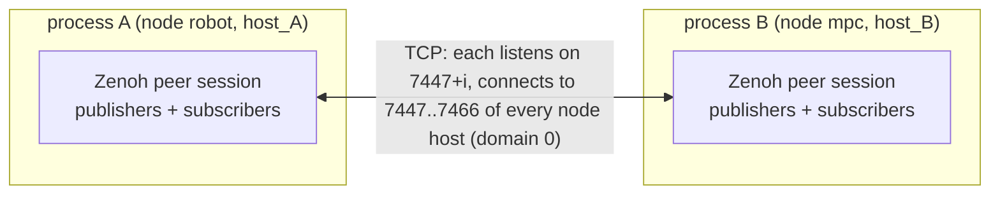

# robot_ipc

The Zenoh bus of the distributed runtime, in C++ (`robot::ipc`, target `:robot_ipc`) and in Python
(`import robot_ipc`, target `:robot_ipc_py`). The design, the processes and the topics of the MPC are in
[`legged_nmpc/docs/distributed_runtime/README.md`](../../legged_nmpc/docs/distributed_runtime/README.md); this
package is generic and knows none of its messages (the shipped network file only names the MPC's topics to give
each its quality of service).

It uses [Eclipse Zenoh](https://zenoh.io) directly: `zenoh-c`, the C API of the Rust implementation, from the BCR
module `zenoh-c` 1.10.1.bcr.1 (MODULE.bazel), built from source with `rules_rs` and linked statically, and in Python
the `eclipse-zenoh` 1.10.1 wheel, which bundles its own copy. There is no ROS and no router: no rmw, no ROS IDL
packages, no colcon or ament, no `zenohd`.

## The pattern



- Every process opens **one Zenoh peer session** per domain of the network file (`domain_id`), which the buses of the
  process share (`src/SessionRegistry.h`). A bus publishes as its node; a bus without a node name (`nodeName` empty)
  only subscribes.
- Every bus topic is the last chunks of a **Zenoh key expression**, `robot_ipc/<domain_id>/tag_<domain_tag>/<qos
  profile>/<topic>` (`KeyExprs.h`, `python/robot_ipc/key_exprs.py`). A topic is letters, digits, `_` and `/`, not
  starting with a digit and without an empty chunk (`validateTopicName()`), so no topic is a wildcard and a Zenoh tool
  shows the bus's own names. Any process may publish any topic, and a process receives its own topics too. The
  sessions connect in the background and declare their publishers and subscribers to each other, so processes start
  in any order and survive each other's restarts.
- Every publisher and subscriber of a bus declares a **liveliness token**,
  `robot_ipc_endpoints/<domain_id>/tag_<domain_tag>/<publisher|subscriber>/<profile>/<bus id>/<topic>`; the buses
  count each other's tokens (Statistics, below).
- Every sample is the payload of one Zenoh put, one envelope of the wire protocol (`WireProtocol.h`,
  `python/robot_ipc/envelope.py`), little-endian:

  ```text
  uint32 protocol_version     kWireProtocolVersion, 3
  uint64 writer_id            random, one per publisher of a bus
  uint64 sequence_number      1, 2, 3, ... per writer
  int64  source_timestamp_ns  strictly increasing across a bus's topics
  uint32 type_name_length
  char   type_name[...]       e.g. "legged_mpc_msgs.MpcPolicy"
  byte   payload[...]         the serialized protobuf message, to the end
  ```

  `encodeEnvelope()` and `decodeEnvelope()` write and read it in C++, `envelope.Envelope.encode()` and `envelope.decode()`
  in Python. The C++ and the Python bus interoperate on the wire (`:cross_language_test`).
- A bus refuses a sample whose `protocol_version` is not its own (`kWireProtocolVersion` in
  `WireProtocol.h`, `WIRE_PROTOCOL_VERSION` in Python), counts it as `rejected` and logs (rate-limited) which version
  the peer speaks, so that two checkouts that drifted apart say so instead of misparsing each other. Version 1 was the
  four-frame ZeroMQ framing and version 2 the Cyclone DDS envelope, an IDL struct in XCDR. Bump the version with every
  change of the envelope, in both languages at once (`LINT.IfChange(wire_protocol)`).
- Zenoh's threads copy each arriving sample into its subscription's bounded queue and wake the IO thread. Per
  subscription, `kLatest` (`"latest"`) hands over only the newest sample of the topic each time the IO thread drains
  the queue, and drops the older ones unparsed; `kAll` (`"all"`) hands over every sample in order. The queue keeps
  `latestDeliveryHistoryDepth` (4) or `allDeliveryHistoryDepth` (256) samples while the IO thread is busy, and drops
  the oldest beyond that (counted as `missed`, from the gaps in the sequence numbers).
- Across topics, a drain takes up to `maxMessagesPerDrain` samples across the topics and dispatches them in
  the order they were written, by their source timestamps, which every bus makes strictly increasing across its topics:
  `kLatest`'s newest sample at the place it was written. Samples `A1 B1 C1 B2` of the topics A (`kAll`), B (`kLatest`)
  and C (`kAll`) taken in one drain reach the handlers as `A1 C1 B2`. Zenoh gives no such guarantee across drains: the
  profiles have different priorities, and a batched sample may arrive after an express one written later.

## Quality of service

Each topic of the network file names a profile (`QosProfile.h`, `python/robot_ipc/qos_profile.py`); a topic the file
does not list has `default_qos_profile`, `reliable_events` unless the file says otherwise. Every sample crosses a TCP
link, so a sample that leaves a publisher arrives unless its link breaks; the profiles differ in what the publisher
does when its link cannot take a sample at once (congestion control), in priority and in batching. No profile keeps a
history at the publisher: a subscriber gets only what is put after the declarations of the two sessions met, so a
process that restarts is not handed old commands.

| Profile | Congestion control | Priority | Sending | For |
|---|---|---|---|---|
| `latest` | DROP | data | express | streams whose next sample replaces a lost one: observations, robot state, velocity commands, telemetry |
| `reliable_latest` | DROP | data | batched | large or infrequent latest values: MPC policies (0.5-0.75 MB), the MPC status, the FSM state, parameter documents |
| `reliable_events` | BLOCK | interactive high | express | events that must each arrive: FSM commands, throws, configuration saves and their status |

- A `latest` or `reliable_latest` sample that a congested link cannot take is dropped instead of queued (Zenoh waits
  briefly for room first), so a slow link adds no backlog; the subscriber counts the gap as `missed`.
- A `reliable_events` put waits for room in the link's queue, on the IO thread; a broken link is closed when its lease
  (`lease_duration_ms`) runs out.
- The nodes a topic lists as `publishers` declare the topic's Zenoh publisher and its liveliness token in
  `Bus::Create()`, so that the subscribers see it as matched before the first sample. Any other process may still
  publish the topic; its publisher is declared at its first publish.
- The publisher and the subscribers read the profile from the same network file. The profile is a chunk of the key
  expression, so two network files that disagree about a topic's profile never exchange its samples; both sides count
  the other's tokens as `incompatibleQos`.

## Threads

The Zenoh publishers belong to the bus's **IO thread** (the "receive thread" in Python), which `start()` launches and
which sleeps until `publish()`, `stop()`, an arriving sample or a liveliness change wakes it. Zenoh's own threads only
copy arriving samples into the subscription queues and record liveliness changes. Handlers and periodic callbacks run
on the IO thread, one at a time.

| Call | From | Notes |
|---|---|---|
| `subscribe<Msg>()`, `subscribeRaw()`, `addPeriodicCallback()` | any thread, while the bus is not running | refused while it runs and from a handler |
| `start()`, `stop()` | any thread | idempotent; `stop()` joins; from a handler, `stop()` only asks the loop to end |
| `publish()`, `publishRaw()` | any non-realtime thread | serializes on the caller, queues the sample and wakes the IO thread |
| `publishFromIoThread()` | handlers and periodic callbacks | straight to the Zenoh publisher, after whatever `publish()` queued before |
| `topicStatistics()`, `statistics()` | any thread | atomic counters |

Only the IO thread calls `z_publisher_put()`. **A realtime thread never calls the bus.** It exchanges data with a
periodic callback through lock-free mailboxes (`robot::TripleBuffer`, an SPSC queue); the robot process runs such a
callback every millisecond. `publish()` takes a mutex that the IO thread only holds to swap two vectors, but it
allocates and serializes, so it has no place on a realtime thread either. The Zenoh lease has no say in the robot's
safety: its policy timeout runs on its own clock.

Nothing throws out of the IO thread: a handler or callback that throws is logged (rate-limited) and counted, and the
bus carries on. Errors of the API are `absl::Status` values in C++ and exceptions in Python (`BusError` for the state
of the bus or the domain, `ValueError` and `NetworkConfigError` for bad arguments, `InterfaceError` for a node whose
host is another machine's address).

## C++

```cpp
#include "robot_ipc/Bus.h"
#include "robot_ipc/NetworkConfig.h"

ASSIGN_OR_RETURN(robot::ipc::NetworkConfig network, robot::ipc::loadNetworkConfig("config/ipc/network.textproto"));
robot::ipc::BusOptions options;
options.nodeName = "mpc";
options.network = std::move(network);
ASSIGN_OR_RETURN(std::unique_ptr<robot::ipc::Bus> bus, robot::ipc::Bus::Create(std::move(options)));
RETURN_IF_ERROR(bus->subscribe<legged_mpc_msgs::MpcObservation>(
    "robot/mpc_observation", robot::ipc::Delivery::kLatest,
    [](const legged_mpc_msgs::MpcObservation& observation) { /* on the IO thread */ }));
RETURN_IF_ERROR(bus->start());
bus->publish("mpc/policy", policy).IgnoreError();  // ResourceExhausted when the queue is full
```

| Header | Declares |
|---|---|
| `NodeEndpoint.h` | `NodeEndpoint{name, host}`, `isLoopbackHost()`, `isIpv4Address()`, `kLoopbackHost` |
| `QosProfile.h` | `QosProfile::kLatest`, `kReliableLatest`, `kReliableEvents`, `qosProfileName()`, `parseQosProfile()`, `qosPolicy()` |
| `NetworkConfig.h` | `NetworkConfig{nodes, domainId, domainTag, topics, defaultQosProfile, transport}`, `TopicQos`, `TransportOptions`, `loadNetworkConfig()`, `parseNetworkConfig()`, `validateNetworkConfig()`, `validateTopicName()`, `formatNetworkConfig()`, `localhostNetworkConfig()` |
| `SessionConfig.h` | `tcpPortRange()`, `interfaceAddressFor()`, `connectEndpoints()`, `isTcpPortFree()`, `zenohSessionConfig()` |
| `KeyExprs.h` | `dataKeyExpr()`, `parseDataKeyExpr()`, `endpointTokenKeyExpr()`, `parseEndpointTokenKeyExpr()`, `EndpointToken`, `EndpointRole` |
| `Delivery.h` | `Delivery::kLatest`, `Delivery::kAll`, `deliveryName()`, `parseDelivery()` |
| `BusOptions.h` | `BusOptions`: node name, network, poll period, publish queue, drain size, subscription queue depths |
| `TopicStatistics.h` | `TopicStatistics` (below) |
| `WireProtocol.h` | `kWireProtocolVersion`, `EnvelopeHeader`, `encodeEnvelope()`, `decodeEnvelope()`, `envelopeProtocolVersion()` |
| `Bus.h` | `Bus` |

A `subscribe<Msg>()` handler gets a `const Msg&` that is valid for the call only: the bus parses every sample of the
topic into the same object, so that its repeated fields keep their capacity. A sample of another type than `Msg`, or
one that does not parse, is rejected and counted. `localhostNetworkConfig()` is `config/ipc/network.textproto` itself,
built into the library (`:localhost_network_text`).

## Python

```python
import robot_ipc
from legged_mpc_msgs import mpc_status_pb2

network = robot_ipc.load_network_config("config/ipc/network.textproto")
bus = robot_ipc.Bus("operator", network)
bus.subscribe("mpc/status", mpc_status_pb2.MpcStatus, on_status, delivery="latest")
with bus:  # start() on entry, close() on exit
    bus.publish("operator/fsm_command", command)  # False when the queue was full
```

`Bus(node_name, network, *, io_poll_period, publish_queue_capacity, max_messages_per_drain,
latest_delivery_history_depth, all_delivery_history_depth)`, with `subscribe()`, `subscribe_raw()`,
`subscribe_all_topics()` (every sample of every topic of the domain, for tools), `add_periodic_callback()`,
`start()`, `stop()`, `close()`, `publish()`, `publish_raw()`, `publish_from_io_thread()`, `topic_statistics()`,
`statistics()`, `domain_id`, `discovery_peers` (the hosts it connects to) and `domain_config` (the Zenoh
configuration of its session). The network file has `load_network_config()`,
`parse_network_config()`, `validate_network_config()` and `format_network_config()`, as in C++, and
`zenoh_session_config()` and `tcp_port_range()`. `robot_ipc.decode(type_name, payload)` parses a payload by its
type name through the protobuf default descriptor pool (import the `*_pb2` modules first);
`robot_ipc.message_class(type_name)` returns the class.

## The network file

`config/ipc/network.textproto` (and `config/ipc/two_machine.example.textproto` for the hardware split) is a textproto
of `robot_ipc_proto.NetworkConfig` (`proto/network_config.proto`):

```textproto
# proto-file: robot_runtime/robot_ipc/proto/network_config.proto
# proto-message: robot_ipc_proto.NetworkConfig
domain_id: 0
nodes { name: "robot"  host: "192.168.1.10" }
nodes { name: "mpc"    host: "192.168.1.20" }
topics { name: "mpc/policy"  qos_profile: "reliable_latest"  publishers: "mpc" }
transport { socket_receive_buffer_bytes: 8388608 lease_duration_ms: 3000 }
```

| Field | Meaning |
|---|---|
| `domain_id` | the domain, in [0, 232]: its TCP ports below and the second chunk of every key expression |
| `domain_tag` | the third chunk of every key expression (`tag_<domain_tag>`): only processes with the same tag exchange samples (two robots on one network; the tests) |
| `nodes` | `name` (the node a process publishes as, `--ipc_node`) and `host` (its machine, an IPv4 address or a host name) |
| `topics` | `name`, `qos_profile` and the `publishers` whose buses declare the publisher up front |
| `default_qos_profile` | the profile of an unlisted topic; `reliable_events` when empty |
| `transport` | `socket_receive_buffer_bytes` and `socket_send_buffer_bytes` (TCP `so_rcvbuf` and `so_sndbuf`, capped by the kernel at `net.core.rmem_max` and `wmem_max`, which `tools/deploy/socket_buffers.sh` and `make socket-buffers` raise), `max_processes_per_host` (20), `lease_duration_ms` (3000) |

Both loaders parse it strictly: a syntax error, an unknown field or a value of the wrong type names the file, the line
and the column. A retired field names its replacement: the `port` and `bind_host` of the ZeroMQ nodes, and the
transport fields `max_message_size_bytes`, `writer_unacked_bytes_limit` and `simulated_send_loss_per_mille` of the
earlier bus (rehearse a lossy link with netem instead, `tools/deploy/README.md`). An invalid entry (a duplicate name, a wildcard
host such as `0.0.0.0`, an invalid topic name, an unknown profile, a publisher that is no node, or a domain id outside
[0, 232], whose ports would reach the ephemeral ports) names the entry.

**The Zenoh configuration** of each process is generated from the file (`SessionConfig.h`,
`python/robot_ipc/session_config.py`, the same text in both languages) and passed to `z_open()` and `zenoh.open()`: no
JSON5 file, and `ZENOH_CONFIG` is never read (`:bus_test` and `:bus_py_test` set it to a file that does not exist). It
is a peer session, without a router: a TCP listener on the node's host (a host that is no address of this machine is
`Unavailable`; a subscriber uses 127.0.0.1 on a loopback network, else the first node host of this machine),
connections to every port of the domain on the host of every node, multicast scouting off, gossip on (a session learns
of its peers' peers), and the lease and the TCP buffers of `transport`. The buses of one process share the session of a
domain (`src/SessionRegistry.h`); two that ask for different configurations of it are `FailedPrecondition`.

<!-- LINT.IfChange(zenoh_ports) -->
**Ports.** TCP only. A process listens on the lowest port free when it opens its session (`isTcpPortFree()`) of
`7447 + 100 * domain_id + i`, for i below `max_processes_per_host`: **7447-7466** for domain 0 on every machine
(`tcpPortRange()`). Every process connects to every port of that range on the host of every node, except its own
listener; Zenoh retries the ports without a listener in the background, so the processes start in any order. A
firewall between the robot and the laptop opens that TCP range; the bus sends no UDP and no multicast.
<!-- LINT.ThenChange(//robot_runtime/robot_ipc/include/robot_ipc/SessionConfig.h:zenoh_ports) -->

## Statistics

Per topic, readable from any thread (`TopicStatistics.h`, the Python `TopicStatistics`):

| Counter | Meaning |
|---|---|
| `written` | samples handed to the Zenoh publisher - not samples delivered |
| `sendDropped` | refused: the publish queue was full, or Zenoh refused the put |
| `received` | samples taken from the subscription's queue |
| `delivered` | handed to the handler (including those whose handler then threw) |
| `superseded` | `kLatest`: replaced by a newer sample of the same drain before it was parsed |
| `rejected` | another wire protocol version, another type, or a payload that does not parse |
| `handlerErrors` | handler calls that threw |
| `missed` | gaps in each writer's sequence numbers: samples a writer put that the subscription never took (replaced in its queue while the IO thread was busy, or dropped by a congested link), counted from each writer's second sample |
| `incompatibleQos` | the live liveliness tokens of the topic, on any bus, whose profile is another than this bus's |
| `matchedReaders`, `matchedWriters` | the live liveliness tokens of the topic's subscribers (while this bus publishes it) and publishers (while it subscribes to it) with this bus's profile, on any bus, this one included: the peers that are up |

After a drain, `received == delivered + superseded + rejected`. The last three come from the liveliness tokens, as the
IO thread last saw them. A publisher cannot tell which subscriber a dropped sample did not reach: the subscriber's
`missed` against the publisher's `written` shows what a link lost. The matched counts replace the heartbeats and
reconnects of ZeroMQ: a bus that stops is unmatched when its tokens go, at once when it closes, and when its link's
lease (`lease_duration_ms`, 3 s by default) runs out when its process crashes.

## Tests

`bazel test //robot_runtime/robot_ipc/...` runs, each test process on a domain and tag of its own
(`isolatedTestNetwork()` in `test/TestNetwork.h`, `robot_ipc.isolated_test_network()` in Python), so that tests that
run at once never see each other's samples:

- `:network_config_test`, `:network_config_py_test`: parsing; a table of malformed textprotos, each rejected with its
  line and column; a table of invalid entries, each rejected naming it; `format` and `parse` round-tripping; the
  shipped files; the generated Zenoh configuration, the port mapping and the connect endpoints; the key expressions,
  the liveliness tokens and the envelope. The two languages check the same tables (`LINT.IfChange`);
- `:bus_test`, `:bus_py_test`: separate topics, `kLatest` against `kAll` on a burst, the order across topics within one
  drain, the envelope on the wire and the refusal of another protocol version or type (from a raw Zenoh put), the
  newest value a stalled subscriber gets, the counters' invariants and `missed`, publishers declared up front, matched
  counts, the buses of a process sharing a session, several publishing threads, a subscriber started before its
  publisher, a restarted publisher, a prompt `stop()`, drops at the publish queue's capacity, throwing handlers,
  periodic callbacks, a policy-sized sample;
- `:cross_language_test`: Python publishes, the C++ `:bus_echo` binary answers; both generate the same session
  configuration for the same listen port; 0.75 MB policies cross the processes whole;
- `:textproto_test`: the strict parser on its own: unknown fields, fields given twice, deprecated fields and syntax
  errors each name their line and column.

The protos (`proto/network_config.proto`, package `robot_ipc_proto`; the test messages `test/test_sample.proto`,
`test/test_event.proto` and `test/test_settings.proto`, package `robot_ipc_test`) follow the repository's proto rules:
one message per file named after it, its `// Next ID` comment and `reserved ... to max;` line, and the nproto struct
option.
